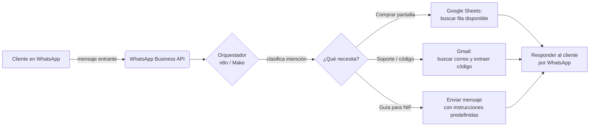

## ¿Es posible?

Sí, es totalmente posible, y no necesitas saber programar para lograr una primera versión funcional. Antes de empezar, hay una decisión clave que cambia todo el diseño:

<Warning>
  Automatizar **WhatsApp Web** haciendo clic en el navegador (con herramientas no oficiales tipo
  bot de navegador) viola los Términos de Servicio de WhatsApp y puede terminar en el **bloqueo
  permanente del número**. La alternativa correcta y estable es la **API oficial de WhatsApp
  Business (Meta Cloud API)**, que no depende de tener una pestaña abierta ni de simular clics.
</Warning>

Con la API oficial, tu agente ya no "va a revisar una pestaña de WhatsApp": los mensajes de tus clientes le llegan automáticamente a un programa (llamado *webhook*), sin que nadie tenga que tener el navegador abierto ni la sesión iniciada.

## Arquitectura recomendada

En vez de tres pestañas del navegador que un agente "va mirando", la forma robusta de construirlo es con un **orquestador** que conecta tres servicios:



**Piezas:**

1. **Canal de entrada:** WhatsApp Business API (Meta Cloud API, gratis hasta cierto volumen) o un proveedor como Twilio, que te da un webhook oficial.
2. **Orquestador / "el agente":** [n8n](https://n8n.io) (recomendado para empezar, tiene versión gratuita self-hosted y nodo de IA integrado) o [Make.com](https://www.make.com). Aquí vive la lógica: clasificar el mensaje, decidir qué rama seguir, llamar a Sheets/Gmail, responder.
3. **Inventario:** Si el archivo hoy es un Excel de escritorio, muévelo a **Google Sheets** (o usa Excel Online con la API de Microsoft Graph). Un archivo `.xlsx` guardado localmente no puede ser consultado en tiempo real por un agente en la nube; una hoja en Google Sheets sí.
4. **Soporte / códigos:** Gmail API (con OAuth), para que el agente busque el correo del proveedor del servicio, extraiga el código de verificación y se lo pase al cliente por WhatsApp.

## Paso a paso

### 1. Preparar las cuentas y accesos

<Steps>
  <Step title="Cuenta de WhatsApp Business API">
    Crea una cuenta en [Meta for Developers](https://developers.facebook.com/), crea una App tipo
    "Business", agrega el producto **WhatsApp** y obtén tu número de prueba. Necesitarás el
    `Phone Number ID` y un `Access Token`. Si no quieres lidiar con Meta directamente, puedes usar
    [Twilio WhatsApp API](https://www.twilio.com/whatsapp) o [360dialog](https://www.360dialog.com/),
    que simplifican el proceso.
  </Step>
  <Step title="Migrar el Excel a Google Sheets">
    Sube tu archivo de pantallas/cuentas disponibles a Google Drive y ábrelo como Google Sheets.
    Deja columnas claras, por ejemplo: `cliente`, `telefono`, `pantalla_id`, `estado` (disponible /
    vendida), `fecha_venta`, `correo_asociado`.
  </Step>
  <Step title="Habilitar Gmail API">
    En [Google Cloud Console](https://console.cloud.google.com/), crea un proyecto, habilita
    **Gmail API** y **Google Sheets API**, y genera credenciales OAuth 2.0. Estas mismas
    credenciales de Google sirven tanto para leer la hoja de cálculo como para leer/enviar correos
    de Gmail.
  </Step>
  <Step title="Crear tu cuenta de n8n">
    Puedes usar [n8n Cloud](https://n8n.io) (de pago, sin instalar nada) o instalarlo gratis en un
    servidor propio o incluso en tu computadora con Docker:
    ```bash
    docker run -it --rm -p 5678:5678 n8nio/n8n
    ```
    Esto te da un editor visual de flujos en `http://localhost:5678`.
  </Step>
</Steps>

### 2. Construir el flujo en n8n (el "agente")

<Steps>
  <Step title="Nodo de entrada: WhatsApp Trigger">
    Conecta el webhook de WhatsApp Business API a n8n. Cada mensaje entrante de un cliente
    disparará el flujo automáticamente.
  </Step>
  <Step title="Nodo de clasificación (IA)">
    Agrega un nodo de IA (por ejemplo, el nodo "AI Agent" de n8n con un modelo de Claude u
    OpenAI) con una instrucción como:
    <br />
    *"Clasifica el mensaje del cliente en una de estas categorías: COMPRA, SOPORTE, GUIA_NIF, OTRO.
    Responde solo con la categoría."*
    <br />
    Este nodo es el que decide qué rama del flujo sigue.
  </Step>
  <Step title="Rama COMPRA → Google Sheets">
    Nodo "Google Sheets → Search Rows" filtrando por `estado = disponible`. Si encuentra una fila,
    actualízala a `vendida` (nodo "Update Row") y responde al cliente con los datos de esa
    pantalla. Si no hay ninguna disponible, responde indicando que no hay stock.
  </Step>
  <Step title="Rama SOPORTE → Gmail">
    Nodo "Gmail → Search" buscando el correo más reciente del remitente del servicio (por ejemplo
    `from:noreply@streamingservicio.com` y el correo asociado al cliente, que sacas de la fila de
    la hoja). Con un nodo de "IA" o una expresión regular, extrae el código de 6 dígitos del cuerpo
    del correo y respóndelo al cliente por WhatsApp.
  </Step>
  <Step title="Rama GUÍA_NIF → mensaje predefinido">
    No necesita IA ni APIs externas: simplemente responde con un mensaje de texto (o una imagen/PDF
    adjunto) con el paso a paso para ingresar el NIF, guardado como plantilla dentro del propio
    flujo.
  </Step>
  <Step title="Nodo de salida: responder por WhatsApp">
    Todas las ramas terminan en un nodo "WhatsApp → Send Message" que le contesta al cliente en el
    mismo chat de donde escribió.
  </Step>
</Steps>

### 3. Probar antes de lanzar

- Prueba cada rama por separado con mensajes de ejemplo ("quiero comprar una pantalla", "necesito mi código", "cómo pongo mi NIF").
- Verifica que la hoja de cálculo se actualiza correctamente y que no se vende dos veces la misma pantalla (usa el bloqueo de fila o revisa el `estado` justo antes de marcarla).
- Empieza con el número de prueba de WhatsApp antes de pasar a producción con clientes reales.

## Alternativa con código (para más adelante)

Si más adelante quieres mover esto a código propio en vez de n8n/Make, la equivalencia sería:

- **WhatsApp:** SDK oficial de [Meta Cloud API](https://developers.facebook.com/docs/whatsapp/cloud-api) o [Twilio](https://www.twilio.com/docs/whatsapp), recibiendo mensajes vía webhook en un servidor Node.js/Python.
- **Hoja de cálculo:** librería `googleapis` (Node.js) o `gspread` (Python) para leer/escribir en Google Sheets.
- **Gmail:** Gmail API con `googleapis` o `google-api-python-client`.
- **"Cerebro" del agente:** llamada a la API de un modelo de lenguaje (por ejemplo, Claude vía [Anthropic API](https://docs.anthropic.com)) que decide la intención y redacta la respuesta.

## Nota importante

Antes de lanzarlo, confirma que la venta/soporte de estas "pantallas" cumple con los términos de servicio del proveedor original del contenido/servicio que estás revirtiendo — esto evita bloqueos o suspensiones más adelante que afecten a tus clientes.
